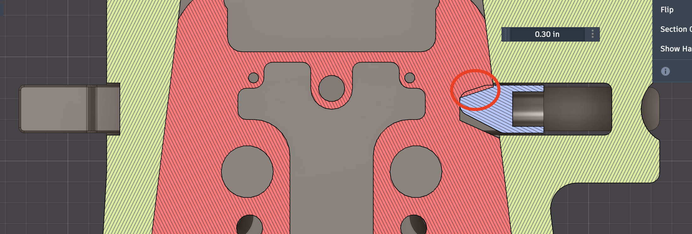
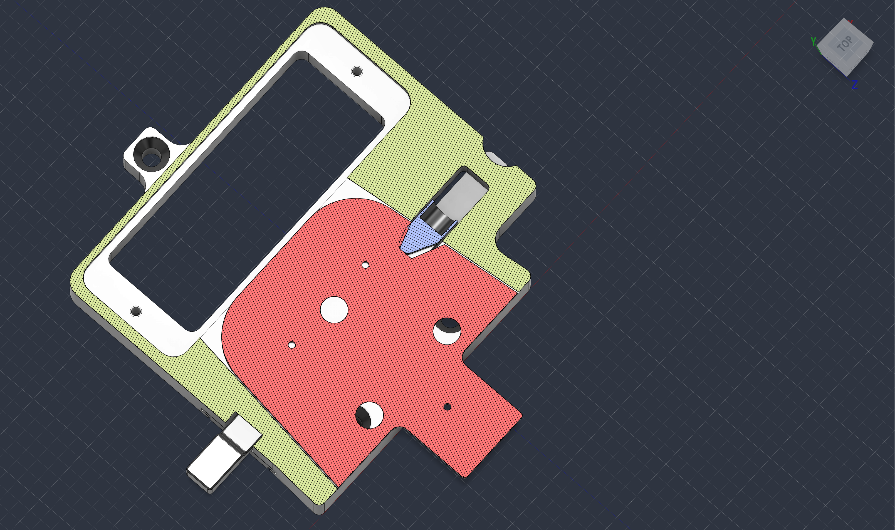
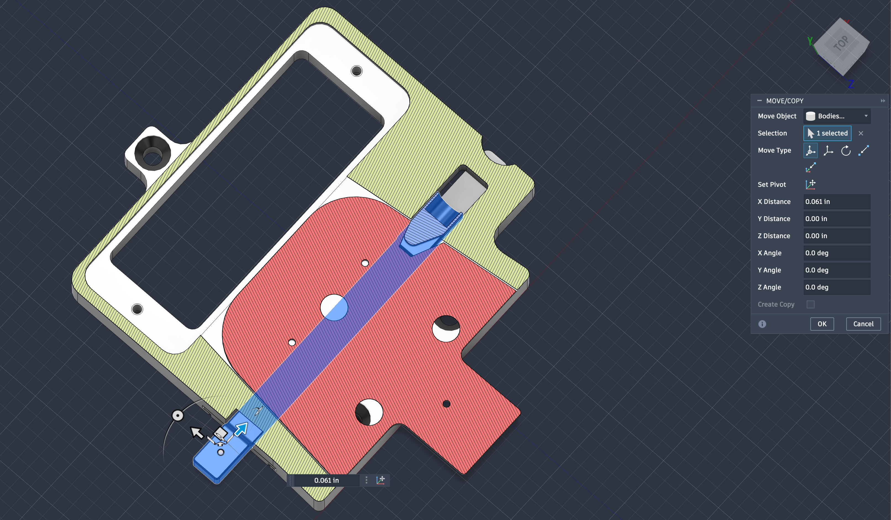

<!-- Title: 13122514, 13122515 and 13122518: the latch notch does not align with the button, and the halves do not seat fully -->

When you connect the two halves, the `13122515` button does not latch fully, and the `13122518` V-Mount does not seat fully in the `13122514` V-Mount Base.

The cause is in the v3.3 assembly model (`19200_13122513_asm_v3-3.stp`). The `13122518` notch is approximately 0.025 in from the position where it aligns with the button.

| Measurement in the assembly model | Value |
|---|---|
| Interference between the `13122515` button tip and `13122518` | 0.0004 in³ |
| Clearance between the `13122518` taper faces and the `13122514` taper faces | 0 (line-to-line) |
| Button retraction that removes the interference | 0.061 in |
| Additional `13122518` insertion that aligns the notch with the button | 0.020 in to 0.030 in |

### Why this is a problem

The taper faces stop `13122518` before its notch aligns with the button. The button tip touches the side of the notch and cannot go into the notch. The spring pushes the button chamfer against the side of the notch, and this pushes `13122518` back out of `13122514`. Thus neither part seats fully.

The v3.3 change "Offset taper faces to eliminate play between parts" on `13122514` removed the clearance at the taper faces. The notch and the button did not move to agree with this change.

### Fix

- [ ] Align the `13122518` notch with the `13122515` button when the taper faces touch. To do this, move the button slot in `13122514`, move the notch in `13122518`, or decrease the taper offset in `13122514`.
- [ ] Give clearance at the taper faces for the machining tolerance and the hard anodize.
- [ ] Record the change in the Change Log, and export new STEP files and drawings.

### Check

- [ ] Do an interference analysis on `19200_13122513_asm_v3-3.stp`. Make sure that there is no interference between `13122515` and `13122518`.
- [ ] Connect a set of machined and anodized halves. Make sure that the button latches fully and that `13122518` seats fully in `13122514`.

### Screenshots

Section through the button axis. The circle shows where the button tip and the side of the notch do not align.

Assembly model as released. The button tip is not fully in the notch.

The button moved 0.061 in along its axis.
